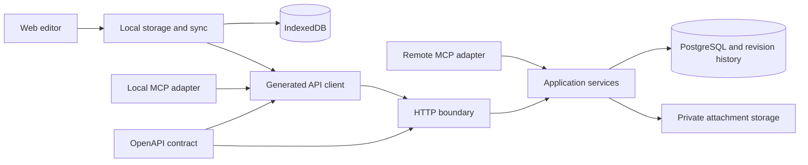

# 001: Initial design

Status: superseded by [docs/plans/003-v0.1-revamp.md](../plans/003-v0.1-revamp.md)

## Decisions

Superseded before a decision record existed. See
[docs/decisions](../decisions/README.md).

Date: 2026-09-05

Status: Self-review complete. Implementation has not started.

This document defines the initial notes application. Offline editing, file version control, an OpenAPI-generated client, and one-pane live Markdown editing are required. The server administrator is trusted to read notes. The choices below are implementation decisions. Performance targets remain unmeasured.

Export is a separate future feature. This design does not include export endpoints, formats, jobs, UI, or a PDF worker. Unit and integration tests are part of implementation. E2E tests are required for release, but their authoring, setup, and execution must wait until the final stage and the user's explicit go-ahead.

## 1. Architecture

Use a TypeScript monorepo with one web application, one modular server, and a local MCP adapter. PostgreSQL stores accounts, access rules, file metadata, Markdown content, immutable revisions, and sync records. A private server volume stores immutable attachment content. IndexedDB stores the browser's working files, checkpoints, and sync queue.

The browser saves locally before sending changes. The server holds the accepted workspace state and durable history. Several devices or workspace members can edit offline. Conflicting changes are preserved as separate revision branches and resolved explicitly. Live shared cursors and simultaneous character-level collaboration are outside this feature.

Use application-managed file version control in PostgreSQL. Revisions and permission checks can then commit in the same database transaction. Do not add a Git repository as a second live data store. Git remotes, Git commands, and user-managed Git branches are outside this design. Files retain stable IDs, paths, content, and history through the application API.



### Stack and dependency policy

Use stable releases checked on 2026-09-05. Pin direct dependencies and the package manager, and generate a frozen lockfile during implementation. Recheck registry versions immediately before that install. Do not use prereleases or force incompatible nested dependencies to newer major versions. The current repository has no installed application or lockfile.

| Area | Selected version or package | Responsibility |
| --- | --- | --- |
| Runtime | Node.js 26.8.1 | Application and server tests. This is the Current release line. |
| Language | TypeScript 7.0.2 | Strict application compilation and type checks. |
| Package manager | pnpm 12.3.4 | Workspace dependencies and reproducible installs. |
| Web | React and React DOM 19.2.8, Vite 8.2.2, React Router 8.3.1 | Application shell and navigation. |
| UI | Tailwind CSS 4.3.3, Base UI 1.8.0 | Theme variables and accessible controls. |
| Editor | CodeMirror state 6.7.4, view 6.43.11, commands 6.11.0, language 6.12.4, Markdown 6.5.2 | Source-preserving live preview. |
| Markdown | unified 11.0.5, remark-parse 11.0.0, remark-gfm 4.0.1, remark-math 6.0.0, remark-rehype 11.1.2 | Parsing and shared content rules. |
| HTML | rehype-sanitize 6.0.0, rehype-stringify 10.0.1 | Safe rendered content. |
| Rich content | KaTeX 0.18.5, Mermaid 11.17.2 | Inline math and diagrams. |
| HTTP server | Fastify 5.12.3 | Routes and transport adapters. |
| Contract | OpenAPI 3.1.2, JSON Schema 2020-12 | The authoritative HTTP interface. |
| Contract tooling | Redocly CLI 2.51.2, Ajv 8.20.0, ajv-formats 3.0.1 | Specification checks and runtime validation. |
| Client generation | @hey-api/openapi-ts 0.99.0 | Typed operations, serializers, and fetch transport generated from OpenAPI. |
| Database | PostgreSQL 18.6, Drizzle ORM 0.45.2, Drizzle Kit 0.31.10, pg 8.23.0 | Persistence and reviewed SQL migrations. |
| Browser database | Dexie 4.4.5 | IndexedDB transactions and schema migrations. |
| PWA | vite-plugin-pwa 1.3.0, Workbox 7.4.1 | Application cache and update lifecycle. |
| Identity | Better Auth and @better-auth/oauth-provider 1.7.2 | Local accounts, OIDC, sessions, and MCP authorization. |
| MCP | @modelcontextprotocol/server, client, fastify, and node 2.0.0 | Maintained protocol adapters. |
| Quality tools | Oxlint 1.81.0, oxlint-tsgolint 7.0.2001, Prettier 3.9.6 | Import rules, lint, and formatting. |
| E2E tooling | Playwright 1.63.0 | Reserved for the final stage after explicit user authorization. |
| Deployment | Docker Engine 29.8.0, Compose 5.5.1 | Reference deployment environment. |

Node 26 is selected to follow the requested current stack. pnpm 12 uses the `latest-12` channel. The selected OpenAPI dialect is a deliberate tooling compatibility choice; package freshness does not require adopting every new specification revision. [Node releases](https://nodejs.org/en/about/previous-releases), [pnpm installation](https://pnpm.io/installation), [OpenAPI 3.1.2](https://spec.openapis.org/oas/v3.1.2.html).

Keep SDK generation in a separate tooling workspace with TypeScript 6.0.3. The generator uses the JavaScript compiler API that TypeScript 7 does not expose. The generator's peer range also accepts TypeScript 7, so the tooling workspace must pin TypeScript 6.0.3 exactly. Application code and generated output are checked with TypeScript 7. Better Auth's dependency context retains @better-auth/utils 0.4.2, as required by its upstream dependency and peer ranges. These are explicit compatibility exceptions.

The bundled Hey API fetch client runtime does not compile under `exactOptionalPropertyTypes` (verified on 2026-09-05 with generator 0.99.0 and TypeScript 7.0.2: twelve assignments of `undefined` to optional keys in vendor runtime files). No generator option, newer stable release, or supported non-bundled client resolves this. Decision: `packages/api-client` keeps `strict` and `noUncheckedIndexedAccess` but sets `exactOptionalPropertyTypes: false`, emits declarations, and is consumed only through its emitted declarations by TypeScript project references. Consumers keep `exactOptionalPropertyTypes: true`, and this was verified to still enforce exact optional types on every generated request and response type at the consumer boundary. No consumer may include the generated source files in its own program. Generation sets `output.module.extension` to `.js` explicitly. Hand edits and dependency patches of generated output remain forbidden. [TypeScript compatibility](https://devblogs.microsoft.com/typescript/announcing-typescript-7-0/), [OAuth provider requirements](https://registry.npmjs.org/@better-auth/oauth-provider/1.7.2).

Ajv's 2020-12 validator must be configured explicitly. Do not pass this schema dialect into a default draft-07 validator. New contract tooling versions were checked against their package metadata. [Ajv dialects](https://ajv.js.org/json-schema.html), [Ajv package](https://registry.npmjs.org/ajv/8.20.0), [Formats package](https://registry.npmjs.org/ajv-formats/3.0.1), [Redocly package](https://registry.npmjs.org/@redocly/cli/2.51.2).

### Code structure and dependency boundaries

The following is the implementation structure. Only this design document is created at the design stage.

```text
apps/
  web/                    Application composition and feature screens
  server/                 HTTP, remote MCP, auth, and server composition
  mcp-stdio/              Local MCP tools backed by the generated HTTP client
packages/
  api-contract/           OpenAPI source, schemas, and generated validators
  api-client/             Generated HTTP client and client configuration
  core/                   Domain rules, use cases, and persistence interfaces
  storage-server/         PostgreSQL and attachment implementations
  storage-browser/        IndexedDB schema and local persistence
  sync/                   Revision exchange and local queue state machine
  markdown/               Parsing, link extraction, and safe rendering
  editor/                 CodeMirror live preview and editor commands
  ui/                     Tokyo Night tokens and reusable controls
tools/sdk-codegen/       Isolated client and contract generation tools
tests/integration/      Contract, database, auth, and storage integration tests
tests/e2e/              Reserved path; created only after user go-ahead
```

Inside `core`, group code by capability: identity, workspaces, files, history, sharing, and search. Each capability has domain rules and application use cases. Keep HTTP DTOs, React state, database records, and domain objects separate. Adapters translate between them.

The core owns server repository interfaces and imports no Fastify, React, Drizzle, Dexie, or generated HTTP client. Server storage implements those interfaces. Only server composition supplies concrete storage and identity adapters. The sync package owns local persistence interfaces; browser storage implements them and web composition connects them. Browser sync uses the generated client. The editor knows Markdown and local commands; it does not know endpoints, database tables, or token storage. Import checks prevent browser packages from loading server storage, Node-only modules, or server secrets.

Each package exposes a small public entry point. Enforce an acyclic import graph with lint rules and package exports. Forbid imports into another package's internal files. Avoid generic catch-all utility packages. Use a package when code has a separate runtime, dependency boundary, or independent public contract; use a module for smaller capabilities inside that boundary.

Use strict TypeScript, `noUncheckedIndexedAccess`, and `exactOptionalPropertyTypes`. Accept `unknown` at untrusted inputs and narrow it through validation. Avoid `any`, unchecked assertions, global mutable services, and exceptions used as normal business outcomes. Inject clocks, ID generation, and external services where deterministic tests need them. Use explicit domain errors mapped at transport boundaries.

Use conventional commits, reviewed migrations, a committed lockfile, deterministic generation, and reviewable dependency updates. Document non-obvious invariants near their implementation. Tests and import checks enforce the structure; a directory layout alone does not establish clean code.

### Standards used

| Area | Standard and application |
| --- | --- |
| HTTP | RFC 9110 for conditional requests, caching, and status semantics. |
| API contract | OpenAPI 3.1.2 and JSON Schema 2020-12 for documented operations and validation. |
| API errors | RFC 9457 Problem Details with stable application error codes. |
| Identity | OIDC authorization code flow, PKCE, verified issuer and subject, and maintained OAuth implementations. |
| Security | Applicable OWASP ASVS 5.0 Level 2 controls for access, sessions, input, files, and data protection. |
| Accessibility | WCAG 2.2 AA for keyboard use, focus, text contrast, status messages, and touch targets. |

These are verification targets, not a claim of certification. [HTTP semantics](https://www.rfc-editor.org/rfc/rfc9110.html), [Problem Details](https://www.rfc-editor.org/rfc/rfc9457.html), [OWASP ASVS](https://owasp.org/www-project-application-security-verification-standard/), [WCAG 2.2](https://www.w3.org/TR/WCAG22/).

## 2. Components and validation

### OpenAPI contract and generated client

`packages/api-contract/openapi.yaml` is the authoritative application HTTP contract. Define operations, stable operation IDs, request and response schemas, errors, authentication, pagination, binary content, and preconditions there. Shared schema fragments remain inside that package. Do not maintain parallel handwritten TypeBox or Zod request definitions.

Bundle and validate the specification with Redocly. Generate the client with Hey API and compile boundary validators from the same schemas with Ajv. Request and response models must distinguish input-only and output-only fields. Define query and path serialization explicitly. Contract generation must produce the same files from the same input. [Hey API fetch client](https://heyapi.dev/docs/openapi/typescript/clients/fetch).

All application HTTP operations in the web app, sync engine, and stdio adapter use generated operation functions. This includes authentication actions, history, attachments, and multipart uploads. Do not write endpoint-specific `fetch`, Axios calls, URL builders, request serializers, response interfaces, or duplicate API wrappers by hand. The handwritten client configuration may set the base URL, credentials, token provider, cancellation, and shared error handling. The generated transport owns network serialization.

Authentication protocol endpoints remain implemented by Better Auth. The contract build includes the configured authentication API's schema, and integration tests verify it against those handlers. Implementation decision (Task 5): the schema fragment is written declaratively in the generator from the pinned Better Auth configuration, because Better Auth's own OpenAPI plugin output does not meet this contract's rules (explicit parameter serialization, closed write bodies, declared 413 and 415, RFC 9457 errors). The fragment's request and response schemas are enforced on the protocol routes at runtime, and one integration test per declared auth operation proves the fragment matches the handler. OIDC uses Better Auth's generic OAuth plugin registered as a social provider, so browser sign-in and callback use the `/api/auth/sign-in/social` and `/api/auth/callback/{providerId}` paths. OAuth redirects are browser navigation initiated from generated login operations. External OIDC exchanges and MCP protocol traffic use their maintained libraries. The PWA's application asset cache is not an application API wrapper.

The server maps each operation ID to a handler and validates at the HTTP boundary before invoking a use case. Verify one-to-one operation coverage in CI. Regeneration must leave no uncommitted difference. An API change includes the specification, handler, generated client, and tests in the same change.

### Validation ownership

| Boundary | Required checks | Owner |
| --- | --- | --- |
| HTTP input | Path, query, header, body, format, payload size, and unknown-field rules from OpenAPI. | Server HTTP adapter and generated validators. |
| HTTP identity | Session or token validity, CSRF/origin rules, token scope, and actor mapping. | Identity adapter. |
| Application command | Current workspace role, file ownership boundary, expected revision, path uniqueness, quota, and permitted state change. | Core use case inside its transaction. |
| MCP input | Tool shape from shared contract schemas, protocol validity, and authenticated actor. | MCP SDK and adapter, then the same core rules. |
| Browser persistence | Stored schema version, record shape, revision graph links, and interrupted migrations. | Browser storage adapter. |
| Server persistence | Foreign keys, unique paths, revision parent ownership, and row access policy. | SQL constraints and storage adapter. |
| Attachment upload | Byte limit, actual media type, image dimensions, digest, and workspace references. | Attachment adapter. |
| Markdown to DOM | Allowed elements and URLs, sanitization, math limits, and diagram isolation. | Markdown package. |
| HTTP response | Declared shape, selected public fields, and error mapping. | Response adapter and generated response validators. |
| Startup | Configuration schema, secrets, encryption prerequisites, and migration version. | Server composition. |

Validate external shape once at entry and enforce domain invariants where state changes. The browser may validate early for feedback, but the server remains authoritative. Do not repeat request parsing in every internal helper. Return invalid client input as a documented Problem Details response. Reject invalid server output, log a request ID, and return a generic server error without leaking content.

### One-pane live Markdown editor

Use CodeMirror 6 with decorations and inline widgets. Markdown text is the editable source. Formatted content appears in the same editor while the user types. Hide Markdown markers outside the active selection. Reveal the affected syntax when the cursor enters it, then render it again when focus moves away. This is the required Obsidian-like Live Preview behavior. There is no split-screen editor or separate preview workflow. [Obsidian editing modes](https://obsidian.md/help/edit-and-read), [CodeMirror decorations](https://codemirror.net/examples/decoration/).

Render headings, emphasis, lists, links, tasks, images, tables, math, and diagrams in place. Clicking an image, table, math expression, or diagram exposes its source in the same region. A task checkbox uses a normal editor transaction. Keyboard navigation can enter every rendered region. Link activation uses a modifier click on desktop and an explicit action on touch, so a normal click can place the cursor.

Use CodeMirror transactions for changes, undo/redo, selection, and composition. Decorations never rewrite source text. Do not replace the editor document when React rerenders. Preserve IME composition, selection across hidden syntax, clipboard Markdown, and undo grouping. Render only affected visible regions. A syntax error shows editable source and an inline message without disabling the rest of the file.

History and conflict resolution also use the main pane. Show a unified inline diff with inserted and removed lines. Resolve conflicts by choosing or editing each hunk. A user can open a historic revision, inspect it, and return to the current working copy without losing the draft.

The sidebar contains the workspace selector, search, recent files, and a file tree. Backlinks and an outline use a collapsible panel. On phones, navigation is a drawer. Viewer accounts and anonymous shares receive a read-only rendering with the same content rules.

### Tokyo Night appearance

Dark mode uses Tokyo Night Night. Light mode uses Tokyo Night Day. System mode selects between those two palettes using the device preference. Use the upstream palette as the source for application, editor, syntax, menus, diagrams, and diff colors. Keep the upstream license notice when copying palette values. [Tokyo Night theme](https://github.com/folke/tokyonight.nvim).

| Token | Night | Day |
| --- | --- | --- |
| Main background | `#1a1b26` | `#e1e2e7` |
| Sidebar and raised surface | `#16161e` | `#d0d5e3` |
| Main text | `#c0caf5` | `#3760bf` |
| Accent blue | `#7aa2f7` | `#2e7de9` |
| Green | `#9ece6a` | `#587539` |
| Red | `#f7768e` | `#f52a65` |

These values come from the upstream [Night palette](https://github.com/folke/tokyonight.nvim/blob/main/extras/lua/tokyonight_night.lua) and [Day palette](https://github.com/folke/tokyonight.nvim/blob/main/extras/lua/tokyonight_day.lua). Do not use low-contrast comment colors for essential labels. Derive accessible semantic variants within the palette when a text or control combination fails WCAG contrast. Use labels and icons as well as color for save states and conflicts.

Save the user's theme choice in local settings immediately and sync it to the account. Apply it before the first paint. Use locally served fonts, a readable text width, visible focus, reduced motion, and touch controls. Theme changes must not recreate the editor or lose its selection.

### Markdown content and attachments

Support CommonMark, GFM tables/tasks/strikethrough, footnotes, fenced code, inline and display math, and Mermaid fences. Keep unknown source syntax intact. Treat front matter as document content; it cannot set permissions or execute code.

The Markdown package defines parsing, source ranges, link extraction, and safe rendering. The editor and public pages share that contract. Use a common corpus to check their agreement. Disable raw HTML, MDX, and executable plugins. Allow only approved URL schemes and sanitize rendered HTML. KaTeX runs with trust disabled and bounded input. Use a small direct KaTeX adapter because rehype-katex 7.0.1 still selects KaTeX 0.16. The adapter's generated HTML passes a tested math-aware sanitization schema. [KaTeX security](https://katex.org/docs/security).

Mermaid uses strict security settings inside an isolated frame, with fixed configuration and input limits. Do not permit note directives to relax security. Reject oversized graphs before rendering and replace a failed renderer with editable source. [Mermaid security](https://mermaid.js.org/config/schema-docs/config-properties-securitylevel.html).

Support PNG, JPEG, GIF, and WebP uploads. Initial limits are 20 MiB per attachment and 40 megapixels per decoded image. Reject uploaded SVG in this feature. Pasted files receive client-generated IDs and enter IndexedDB before upload. Store immutable attachment bytes with a digest. Replacing an attachment creates a new version; it never changes bytes referenced by an old note revision.

Use immutable attachment revision IDs in Markdown URLs, so replacing a file cannot change an image in historic content. The generated client retrieves authenticated bytes for object URLs; revoke those URLs when no longer used. External images require an explicit user action to load and are unavailable offline unless imported as an attachment. Do not fetch arbitrary external URLs through the server.

### Accounts, workspaces, and access

Support multiple local accounts and administrator-configured OIDC. Each account starts with a personal workspace. Shared workspaces use owner, admin, editor, and viewer roles. All members can read the files and history in their workspace. Editors can create, edit, rename, delete, and restore files. Admins also manage membership and public shares. The owner can transfer ownership or delete the workspace. Prevent removal of the last owner. Per-file deny rules are outside this feature.

Public registration is disabled by default. The installer creates the first owner through a one-time bootstrap command. Administrators invite additional accounts. OIDC can be required per installation. Local password recovery uses SMTP (nodemailer transport, configured by `NOTESAPP_SMTP_URL`); an operator recovery command supports installations without email. Use Better Auth for password hashing and token lifecycle. An invited person without an account accepts the invitation with the invitation token plus a new password on password-enabled installations; the server creates the account itself, so public sign-up stays unmounted. Under an OIDC-only policy the invitation is claimed on the first provider sign-in with the matching address.

OIDC uses authorization code flow with PKCE, state, nonce, and signature/issuer/audience checks. Key external identities by issuer and subject. Never merge accounts solely because their email addresses match. Browser sessions use Secure, HttpOnly cookies and protected cookie-authenticated writes. Agent tokens are revocable, expire, and contain workspace and action scopes. Every operation also checks current membership. [Better Auth OIDC](https://better-auth.com/docs/plugins/generic-oauth).

Core use cases receive a verified actor and action grants from either transport. They enforce both current role and grants, including history reads, branch writes, sharing, and permanent deletion. A remote MCP call cannot bypass a scope check by calling the core directly. Membership changes use the same workspace lock as content writes, so revocation and writes have a defined transaction order.

All persisted child references include a workspace boundary. Use composite foreign keys and unique constraints. PostgreSQL row security provides a second access control with a runtime role that cannot bypass policies. Migration credentials are separate. Better Auth's tables (users, sessions, external accounts, verification tokens) are not workspace scoped; they belong to a third database role used only by the Better Auth connection pool, and the application runtime role reaches them only through narrow `SECURITY DEFINER` lookup functions that never return tokens or hashes. Set identity context per transaction. Keep membership policies non-recursive and test public-share policies separately. [PostgreSQL row security](https://www.postgresql.org/docs/18/ddl-rowsecurity.html).

### File model and version control

A file has a UUID independent of its path. Markdown notes use normalized relative POSIX paths ending in `.md`. Paths are case-sensitive and Unicode NFC-normalized. Reject absolute paths, empty segments, traversal segments, backslashes, and null bytes. Enforce unique live paths inside each workspace. Renames preserve file identity and record old and new paths. Folder operations are atomic changesets over affected paths, with a server limit of 1,000 file changes per operation.

| Record | Stored data and invariant |
| --- | --- |
| File | Workspace, file ID, path, kind, accepted head revision, and deletion state. |
| Content | Immutable Markdown bytes or attachment object reference, digest, and size. Deduplicate only inside a workspace. |
| Revision | Revision UUID, file ID, parent revision IDs, content reference, path, deletion state, changeset ID, actor, client time, server time, and optional message. |
| Changeset | One atomic operation affecting one or more files, actor, device, mutation ID, and request digest. |
| Branch | A divergent tip for a file, its base revision, conflict changeset ID, and unresolved/resolved state. |
| Checkpoint | A locally persisted revision before sync, using the same revision identity. |
| Link index | Source file and revision, resolved target ID or unresolved source reference. |
| Share | Hashed token, pinned revision, allowed attachments, creator, expiry, and revocation. |
| Sync change | Commit-ordered workspace cursor, changed entity IDs, and revision or deletion references. |
| Mutation receipt | Mutation identity, actor, request digest, and stored outcome for safe retries. |
| Purge marker | Workspace and permanently deleted file ID, without content, to reject late offline writes. |
| Membership and audit | Current role and content-free records of protected actions. |

Version control includes history, named checkpoints, inline diffs, restore, rename history, deletion history, and explicit conflict branches. Each accepted checkpoint is immutable. The first revision has no parent. Later normal revisions have one parent. A resolved conflict creates a revision with both branch tips as parents. The accepted head identifies the current version; the graph also retains divergent work.

Persist the working draft frequently, then create a checkpoint after 750 ms of idle time, at least every 30 seconds during continuous editing, and when the user invokes Save or leaves the file. Coalesce only writes to the working draft; every created checkpoint remains immutable. Skip a checkpoint when content and metadata have not changed, unless the user requests a named checkpoint. Draft persistence and checkpoint creation are separate from network sync. Undo changes the working copy; it does not erase accepted history.

Restoring an older revision creates a new revision based on the current head and records the restored source ID. It does not rewind or delete history. Deleting a file creates a tombstone revision, revokes its shares, and removes it from normal search. Restore does not reactivate old public links. Binary history uses version selection, not text merging.

Keep saved revisions and unresolved branches until an explicit permanent file or workspace purge. Do not silently expire history after 30 days. Purge is an owner action with a clear deletion summary. Delete associated shares and branch references before reclaiming content. A quota error stops new server revisions and preserves the local draft; it must not trigger automatic history deletion. Default workspace storage quota is 5 GiB, configurable by the operator, including retained content.

Keep a content-free purge marker for each purged file until workspace deletion. Reject late writes to that ID with a documented 410 response; sync must not recreate it. Pending local content remains available for explicit recovery into a new file ID. Before purging an attachment, show and reject references from retained note history, branches, or shares outside the purge set. Permanent deletion removes live storage content; existing encrypted backups retain it until their stated retention period ends.

Count retained metadata and finalized uploads toward storage usage, including named checkpoints and mutation receipts. Reserve capacity for deletion, purge, share revocation, and access changes so a full workspace can still be managed. Those operations cannot add content. Enforce request size, file count, and rate limits before storing data; rejected requests cannot create unlimited receipts.

### Links, search, and sharing

Offer `[[Title]]` completion and write a stable Markdown link to the selected file ID. Ambiguous titles require a choice at edit time. Keep unresolved source references visible. Renames do not break ID links. Extract links from saved content, and show backlinks only when the actor can read both ends. A link never grants access.

Use PostgreSQL full-text search on accepted Markdown heads and titles, filtered by workspace access. Start with the language-neutral configuration. Histories and conflict branches are excluded from normal results and accessed through history tools. Offline search indexes locally downloaded accepted files and the user's current working content. [PostgreSQL text search](https://www.postgresql.org/docs/18/textsearch-intro.html).

Admins and owners can publish a read-only link to a pinned accepted revision. Later edits remain private until an explicit publication update. Use a random token stored as a hash, optional expiry, and revocation checked on every request. Serve useful HTML without the editor bundle. Only attachment revisions referenced by that share are public. Private target links expose no server-fetched title or snippet; text already written by the author remains part of the published note.

Revoke shares when their file is deleted, their workspace is deleted, or their creator loses sharing permission. Do not cache share pages or private bytes in a CDN or the PWA HTTP cache. Use noindex, no-referrer, and token-redacted logs. A reader can retain a downloaded copy after revocation.

### MCP and API coverage

The generated REST client covers accounts, workspaces, membership, files, attachment transfer, history, checkpoints, branches, merge/restore, search, links, shares, and sync. MCP tools expose the same content operations and enforce the same roles. History reads and restore are available to agents, not only to the UI.

The remote MCP adapter invokes core services after SDK validation. The local stdio adapter uses generated HTTP operations and never receives database credentials or server encryption keys. Use the SDK's Streamable HTTP support and its built-in stateless compatibility for 2025-11-25 clients, alongside 2026-07-28. Do not add a handwritten protocol translator. [MCP Fastify adapter](https://ts.sdk.modelcontextprotocol.io/v2/serving/fastify.html), [MCP compatibility](https://ts.sdk.modelcontextprotocol.io/v2/serving/legacy-clients.html).

Remote MCP uses the configured OAuth provider with protected-resource metadata, audience-bound tokens, PKCE, and consent. Register supported clients explicitly. Validate Host and Origin and pass Fastify's parsed body to the SDK adapter. Browser OIDC login and MCP authorization have separate protocol roles. Note content is untrusted input to an agent and cannot grant new scopes. [MCP authorization](https://modelcontextprotocol.io/specification/2026-07-28/basic/authorization).

## 3. Offline data flow

### Provisioning and local saves

After the first online login, download the active workspace's current Markdown files and metadata in a consistent snapshot. Cache the application shell, editor, fonts, math, and diagram code needed offline. Pin the active workspace's Markdown automatically. Download images on use, with an explicit Make available offline action for all referenced attachments. Show download progress and completeness. Older history is downloaded on demand and can be pinned; local checkpoint history is always retained while pending.

Offline operations include file creation, editing, rename, deletion, local history, checkpoint creation, local restore, and search of downloaded content. New accounts, permission changes, publication, and access to never-downloaded content require the server. The UI shows these operations as requiring a connection. It never presents an unavailable file as an empty note.

Persist local drafts and their queue metadata in one IndexedDB transaction, with a target delay of at most 150 ms after input. Display Saving on this device until that transaction succeeds, then Saved on this device. Checkpoint transactions atomically store content, parent IDs, and queue entries. Show Saved to server only after server acknowledgment. Show Conflict, Storage full, or Save failed when applicable.

IndexedDB persistence is required for the editable application. If storage is unavailable, do not enter normal offline editing; show a storage error and read-only server content. If storage fails during editing, keep the in-memory buffer visible, stop claiming persistence, and allow selection and clipboard copying. Do not silently discard it or reload the page.

### Revision exchange

1. Create client IDs for new files, revisions, attachments, and mutations. Queue records keep account, workspace, device, parent IDs, and content digest.
2. Upload and finalize immutable attachment bytes before sending revisions that reference them. The generated upload operation owns serialization. The server validates bytes before a final reference is usable.
3. Send checkpoint chains through generated sync operations. Serialize submission across all files affected by a changeset and preserve parent order. Include an expected head for each existing file and an absent-file precondition for each new file. Once sent, a mutation's identity and body cannot change.
4. The server validates shape, authenticates, and acquires locks in one order: workspace, mutation identity, then sorted file IDs. Check current membership and action grants first. Then check the mutation receipt: return the stored outcome for an accepted replay with the same digest, or reject a reused mutation ID with different input. Do this before checking current heads or quotas, since a successful first attempt may have changed them. A replay never grants access that the actor has since lost.
5. For a new changeset, check purge markers, quota, parents, all expected heads, and final path uniqueness. The server assigns actor and acceptance time from the authenticated request; client timestamps are informational. Write all revisions, advance heads, update links/search, allocate a sync cursor, and store the receipt in one transaction. Either all file changes commit or none do. Path checks and SQL constraints permit valid atomic path swaps.
6. Acknowledge the changeset and its exact revision IDs together. The browser removes only acknowledged queue entries in a local transaction. Working content and newer checkpoints remain intact. Since each checkpoint has a stable parent ID, normal acknowledgments do not rewrite that graph.
7. Pull ordered changes on start, focus, reconnect, and every 15 seconds while active. Apply remote heads only when they cannot replace unsubmitted work. Otherwise keep both branches.

Use a workspace row lock for commit-ordered cursor allocation. A plain sequence alone can skip a transaction that commits late. Capture initial metadata and its high-water cursor in one repeatable-read snapshot. Use a bounded materialized snapshot token for pagination, with an expiry of 15 minutes and current access checks on each page. Expiry restarts download and preserves local work.

Download content by the immutable revision IDs in that snapshot, never by a later current head. Stage snapshot data separately from local drafts. Mark the workspace ready offline only after all required Markdown and application assets are stored. Then consume changes after its captured cursor. A purged revision or expired snapshot requires a restart; it cannot produce an empty file or erase pending work.

Keep incremental sync records for 90 days. An older cursor requires a fresh snapshot, not lost drafts. Saved revision IDs and parent history remain valid beyond that window. Retain mutation identity, request digest, and outcome until account/workspace purge so a late retry cannot repeat a rename, publication, or other write. Apply quotas to prevent an unbounded write stream.

### Conflicts and restore

Use strong ETags derived from accepted revision IDs. HTTP updates and deletes require `If-Match`; a changed head returns 412. MCP write tools require the equivalent expected revision. A stale update does not alter the accepted head. [HTTP preconditions](https://www.rfc-editor.org/rfc/rfc9110.html).

If device A and device B edit revision R while offline, A may publish revision A1 first. B's normal head update is then rejected. B submits its retained checkpoint chain through the explicit branch operation, with R as the base. The server validates all parent and file references, records B1 as a divergent branch, and leaves A1 current. Failed branch upload leaves B's local copy intact.

The user resolves the difference in one pane using an inline diff. Save the result with A1 and B1 as parents and A1 as the expected current head. If the head changed again, keep the result and repeat resolution against the new head. There is no automatic last-write-wins rule or silent text merge. A rename collision and edit-versus-delete conflict use the same explicit recovery process.

If any file in a multi-file changeset conflicts, preserve the complete changeset as a conflict group. Upload its branches atomically and resolve the group with expected heads for every affected file. Do not publish the files that happened to pass first. Name collisions require an explicit new path or deletion choice before commit. A conflict on a newly created file keeps its proposed ID and content outside the accepted file tree until resolution.

A server restore uses a documented command with the current ETag and historical revision ID. An offline restore creates a local checkpoint from downloaded historical content. Both preserve intervening history. Local history does not imply access to server revisions that were never downloaded.

### PWA lifecycle and access changes

Foreground sync is mandatory. Background Sync is an enhancement and cannot be required for correctness. Browser execution and storage limits vary. Request persistent storage where supported and handle eviction and quota failures. Local browser data is not a backup. [MDN offline behavior](https://developer.mozilla.org/en-US/docs/Web/Progressive_web_apps/Guides/Offline_and_background_operation).

Partition local data by server origin, account, and workspace. Never store private API responses in the service worker's generic cache. Give each editor working copy its own ID and base revision. Separate tabs must not write to one shared draft record. IndexedDB transactions check the local expected head when committing checkpoints; concurrent edits become local branches. Coordinate queue submission through one active sync worker with takeover after failure; server idempotency remains the final protection. Tab messages notify other tabs but are not a persistence mechanism.

Prompt for an application update after local persistence succeeds. Before a database schema upgrade, all open application tabs must save and close their database connections. A blocked upgrade keeps the old application usable and shows the required action. Migrations run transactionally and preserve pending revisions. Retain assets required by active old clients until they reload. Version the sync payload and local queue format; the server rejects unsupported versions without changing data, and a client upgrade migrates pending work before resuming sync.

On reconnect, validate session and membership before sync. Pause for login when the session expired. If read access was revoked, reject new server reads and writes, clear cached server content, and retain pending user edits in an account-bound recovery area for clipboard copying or explicit removal. If the role changed to viewer, stop writes and preserve pending edits for recovery while permitted reads continue. The application must require the original account before it shows recovery content. Account partitioning does not protect plaintext browser storage from a person who controls that browser profile.

Online logout must first settle pending work or receive an explicit discard action, then revoke the session and clear local private content. Offline logout requires explicit discard of pending work, clears local private content, and records a local sign-out marker. It cannot revoke an HttpOnly server session without a connection. On reconnect, process session revocation through the generated client before restoring an account or downloading private content; clear the marker only after revocation succeeds. An offline device can retain content it already downloaded until it reconnects. The trusted-device model accepts that limit and does not claim immediate remote erasure or local end-to-end encryption.

## 4. Server storage and failure handling

### Encryption and deployment

Use encrypted host storage for PostgreSQL data, transaction logs, attachments, backups, and persistent temporary data. Protect swap and crash output under the same policy. The running server and its trusted administrator can read notes. Use HTTPS at the public endpoint and TLS for storage traffic that crosses hosts. [PostgreSQL encryption boundaries](https://www.postgresql.org/docs/18/encryption-options.html).

A Docker volume is not itself encrypted. Installation instructions require an encrypted filesystem or block device before production use. Keep keys outside data backups and document unlock, rotation, restart, and recovery. Startup validates application configuration and required mounts; the host installation check verifies encryption because a container cannot reliably prove it from a mount path.

Compose contains the application and PostgreSQL. Use an existing HTTPS reverse proxy. Serve the application, REST, public pages, authentication, and remote MCP from the same origin. Store attachments on a private local volume. There is no S3 adapter, Redis, export worker, or separate background queue in this initial feature.

Use non-root containers, private database networking, readiness checks, pinned image digests, and reviewed forward migrations run once before readiness. Publish amd64 and arm64 images after validation. Start performance testing on a 2-core, 4 GiB server. This is the test profile, not a proven minimum requirement.

Attachment ingestion writes immutable bytes to a temporary object, verifies them, and finalizes an object record. Reference only finalized objects from revisions. Retry finalization safely. Reclaim abandoned temporary uploads and finalized objects that still have no references after 24 hours. Cleanup and reference creation use the same workspace and object lock order; mark an object unavailable in a transaction before deleting its bytes. A late client must upload the bytes again if cleanup removed the object. Never reclaim content referenced by history, branches, or shares.

The operator backup procedure briefly pauses writes and attachment cleanup, then captures PostgreSQL and its referenced attachment objects as a recoverable set. Keep seven daily and four weekly encrypted backups on separate storage. Verify restoration to an empty installation. Backups protect server loss; file history supports user recovery. They serve different purposes.

### Failure behavior

| Failure | Required behavior |
| --- | --- |
| Lost network or response | Retain local checkpoints and retry the same mutation identity with bounded backoff. |
| IndexedDB failure | Keep the working buffer, show Save failed, and stop claiming persistence. |
| Stale head or path collision | Preserve both versions and require explicit conflict resolution. |
| Missing attachment | Keep the pending note locally and retry attachment transfer before dependent revisions. |
| Invalid parent graph | Reject foreign-workspace, cyclic, missing, or mismatched revision references. |
| Session expiry | Pause sync, keep drafts, and require login before sending data. |
| Membership removal | Reject server access and isolate local recovery content. |
| Database or key unavailable | Fail writes without success acknowledgment; never generate substitute keys for existing data. |
| Invalid Markdown or diagram | Expose editable source and an inline error. |
| Quota exceeded | Reject new server content, retain local work, and preserve existing history. |
| Share expired or revoked | Deny the page and every share attachment route. |
| Failed migration | Keep the new application unready and use the documented restore procedure. |

Use request IDs, stable error codes, and content-free structured logs. Exclude note bodies, search text, password/token values, cookies, and share URLs. Record actor, operation, file IDs, revision IDs, duration, and outcome. Monitor save errors, unresolved conflicts, storage usage, failed login flows, and backup age.

## 5. Verification and delivery

### Tests during implementation

Unit tests are required for domain rules and pure algorithms: permission decisions, path rules, revision parents, conflict detection, restore, idempotency outcomes, checkpoint scheduling, link extraction, Markdown range mapping, and theme selection. Use Node's built-in test runner with injected clocks and deterministic IDs. Exercise public behavior, meaningful boundaries, and failure paths. Do not use coverage-only assertions or snapshots of internal implementation details. [Node test runner](https://nodejs.org/api/test.html).

Integration tests are required for generated-client-to-server contracts, real PostgreSQL transactions, row security under the production role, migrations, attachment storage, auth sessions, and OIDC/OAuth behavior against a controlled identity provider. Test the actual generated client for JSON, query parameters, errors, cookies, ETags, multipart files, and cancellation. Check response validation and operation coverage.

Test local persistence and sync transitions through storage-adapter integration tests, including transaction failure, interrupted migration, blocked upgrades, concurrent tab drafts, worker takeover, duplicate requests, lost acknowledgments, out-of-order network responses, expired cursors, and membership changes during a write. Specifically verify that an accepted replay succeeds after its head has advanced, a failed multi-file change commits no partial result, snapshot downloads use pinned revisions, and late offline writes cannot recreate purged files. Test full-quota control operations, attachment cleanup races, and offline sign-out transitions. These are module or service tests; they must not become full user-journey E2E tests before the authorized final stage.

The development gate runs contract lint, deterministic generation checks, TypeScript 7 checks, Oxlint import rules, formatting, unit tests, integration tests, and production builds. Use strict peer installation and a frozen lockfile. Test generated SDK output with TypeScript 7 while the generator remains isolated on TypeScript 6. Runtime verification has not run at the design stage.

### E2E tests as the final stage

E2E tests are mandatory for the completed release. Write and run them last, after implementation and unit/integration checks are complete and the user gives an explicit go-ahead. Until then, do not create E2E spec files, fixtures, browser harness configuration, or CI jobs, and do not run E2E tests. This sequence is a fixed user constraint, not an unresolved design choice.

After authorization, use Playwright and the real Docker application for full user journeys: initial account setup, OIDC login, multiple workspaces, live preview, Tokyo Night themes, offline restart/edit/reconnect, concurrent devices, history/restore, attachments, public sharing, and revocation. Include keyboard, touch, IME, paste, undo, selection across widgets, and generated-client integration exercised through the UI.

Test current and previous major Chrome, Edge, Firefox, and Safari. Validate installed PWAs and storage behavior on real Android and iOS devices. Automated desktop browser results alone do not prove mobile installation or retention. The release gate requires the authorized E2E suite plus manual device, accessibility, security, upgrade, and backup-restore checks.

### Requirement coverage

| Requirement | Completion evidence |
| --- | --- |
| Markdown viewer/editor | One-pane live preview preserves source and supports normal editing and selection. |
| Minimal UI and themes | Tokyo Night Day/Night, system switching, accessible controls, and phone layout. |
| Fast | Measured performance budgets on the specified corpus and test profile. |
| Web and PWA | Offline create/edit/rename/delete/history, restart, reconnect, and controlled updates. |
| Full API and agents | OpenAPI-generated operations plus MCP coverage for files and history. |
| Docker self-hosting | Clean installation, upgrade, and verified encrypted backup restoration. |
| Web sharing | Anonymous pinned-revision reading with correct attachment and revocation rules. |
| Accounts and OIDC | Local and OIDC login, account isolation, and verified identities. |
| Workspaces | Role and data isolation across UI, API, MCP, search, and history. |
| Rich Markdown | Images, math, Mermaid, tables, tasks, safe rendering, and inline source editing. |
| Encrypted server storage | Verified host encryption, protected keys, and encrypted recoverable backups. |
| Note links | Stable IDs, rename-safe links, backlinks, and access-aware rendering. |
| File version control | Immutable history, checkpoints, diffs, branches, restore, and deletion history. |
| Export | Explicitly outside this feature and reserved for a separate design. |
| Clean code and tests | Enforced dependency boundaries, strict types, unit/integration checks, then authorized final E2E checks. |

### Performance budgets

Use 10,000 notes per workspace, typical Markdown files of 5 to 20 KiB, a 1 MiB stress file, and 20 active users. Record server, phone, browser, and network conditions. These are acceptance targets, not measured results.

| Metric | Target |
| --- | --- |
| Typical typing response | p95 below 50 ms |
| Local draft transaction after input | p95 below 150 ms |
| Open cached typical note | p95 below 150 ms |
| Save service time, excluding network and idle delay | p95 below 200 ms |
| Workspace search service time | p95 below 300 ms |
| First application JavaScript | Below 250 KiB gzip, excluding deferred editor/rich rendering modules |
| Web loading and interaction | p75 LCP below 2.5 seconds and INP below 200 ms on the recorded profile |

Measure editor and rich rendering cost separately from shell size. Precache required offline modules after the first load and display readiness only after completion. Use viewport rendering, incremental decorations, bounded Markdown parsing, and metadata-first navigation. Under a render limit, leave the affected block editable as source in the same pane. Do not use a split-screen fallback.

### Delivery sequence

1. Create workspace boundaries, strict tooling, the OpenAPI contract, generated client, and boundary validation. Add unit and integration tests for each completed capability.
2. Implement identity, workspace access, immutable content, revision history, and transactional file operations.
3. Implement local persistence, offline checkpoints, revision exchange, conflict branches, and restore. Prove failure recovery through unit and integration tests.
4. Implement the one-pane live editor, Tokyo Night UI, safe rich content, links, search, sharing, and MCP operations. Complete Docker, backup, and operational checks.
5. Complete implementation review, contract checks, unit tests, integration tests, and production builds.
6. After explicit user go-ahead, author and execute E2E tests as the final stage, then complete release verification.

All product and architecture choices for this feature are stated above. Export will have its own design. The only deferred authorization is the user-controlled start of E2E work.
